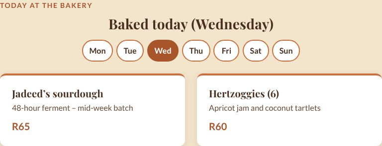
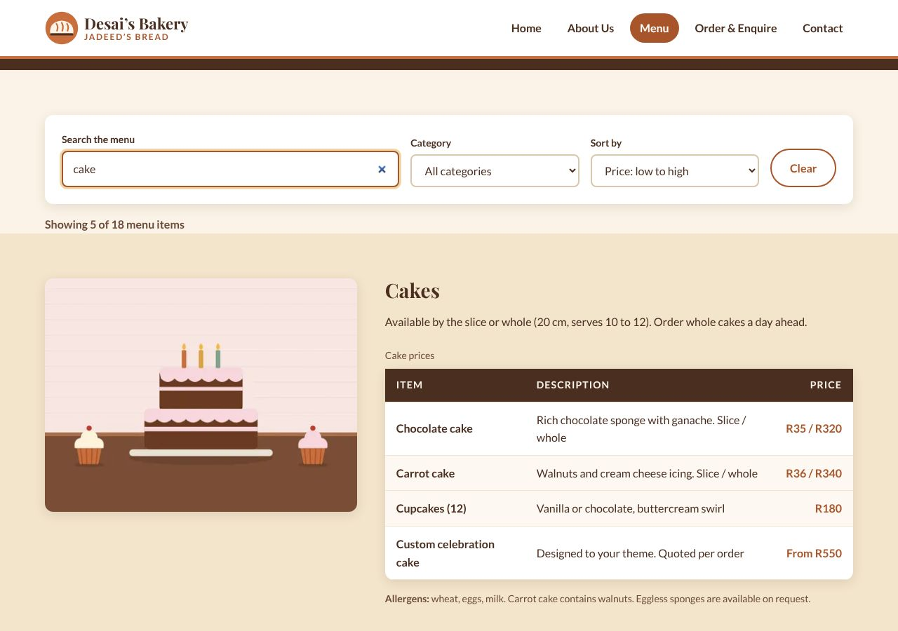
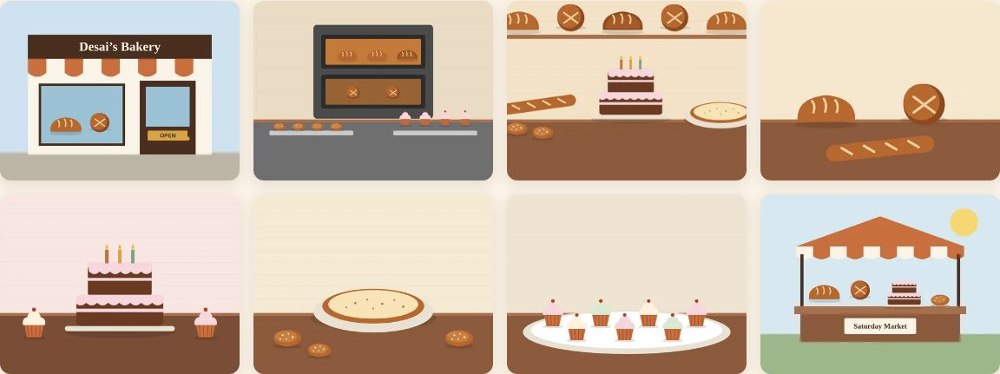
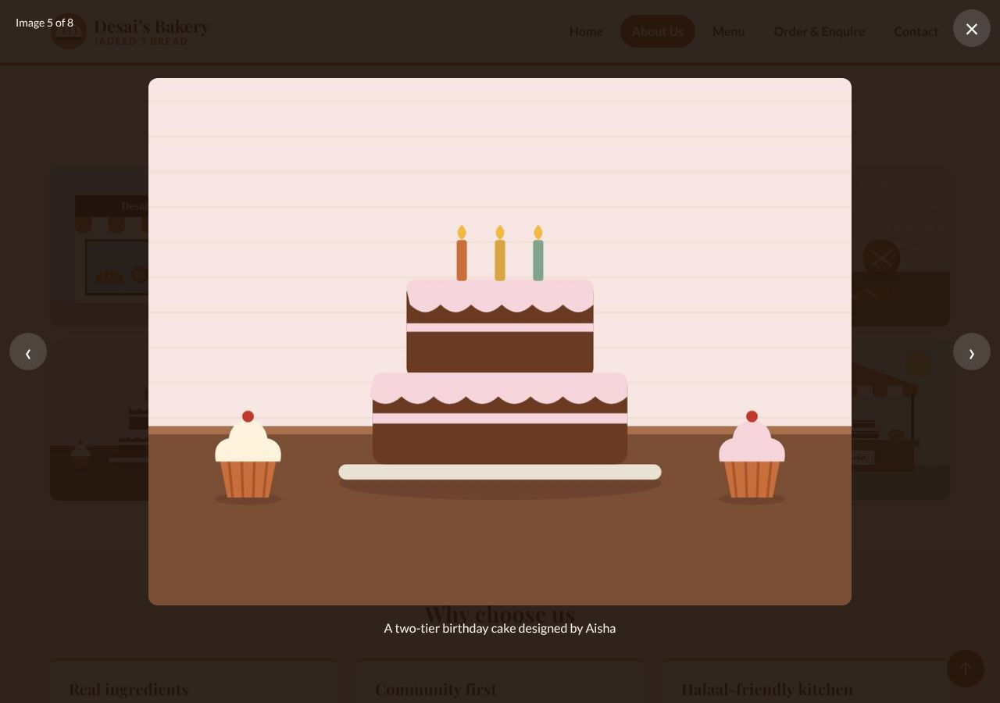
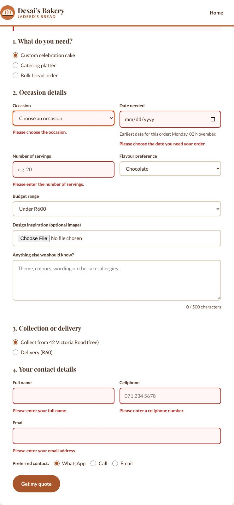
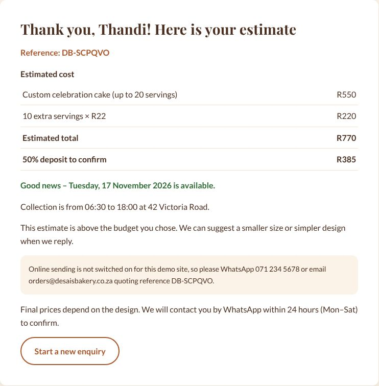
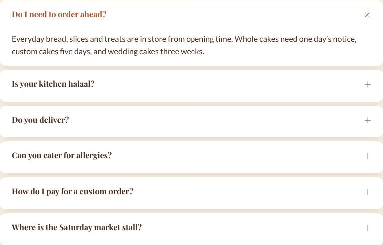
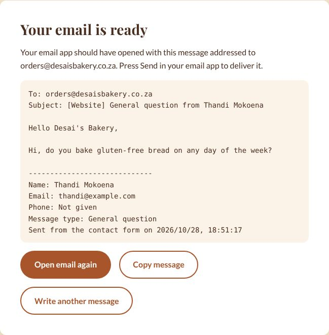
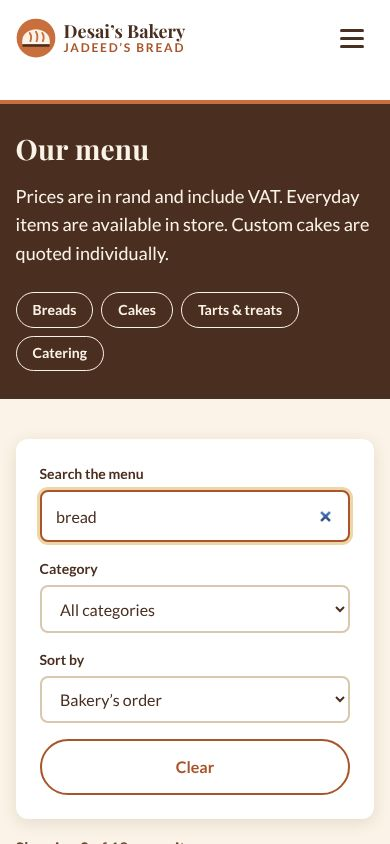

# Desai's Bakery – Jadeed's Bread

A five-page, responsive website for a fictional family bakery in Grassy Park, Cape Town. Built with HTML5, CSS3 and JavaScript for the WEDE5020 Portfolio of Evidence (Parts 1, 2 and 3).

**Live website:** [https://waylonpillay8.github.io/WEDE-POE/WEDE5020-POE-ST10504504/](https://waylonpillay8.github.io/WEDE-POE/WEDE5020-POE-ST10504504/)
**Repository:** [https://github.com/WaylonPillay8/WEDE-POE](https://github.com/WaylonPillay8/WEDE-POE)

---

## Student information

| | |
|---|---|
| **Name** | Waylon Pillay |
| **Student number** | ST10504504 |
| **Module** | WEDE5020 – Web Development (Introduction) |
| **Institution** | The IIE Rosebank College |
| **Submission** | Part 1 (HTML structure) and Part 2 (CSS styling and responsive design) – 25 September 2026 |
| **Part 3** | JavaScript functionality, SEO, form validation and deployment – November 2026 |

---

## Project overview

Desai's Bakery – Jadeed's Bread is a family bakery on Victoria Road, Grassy Park. It started in a home kitchen in 2014 and opened a shop in 2018. On Saturdays it also has a stall at the community market on Klip Road. Almost all orders currently come in by phone and word of mouth, and the bakery has no website.

This project gives the bakery its first website. Customers can:

- see the menu and prices without phoning
- find both locations on a map, with trading hours
- send a structured enquiry for custom cakes and catering

The business, people, addresses and phone numbers are **fictional**, but written to be realistic for a small bakery on the Cape Flats.

---

## Website goals and objectives

| Goal | KPI (measure of success) |
|---|---|
| Build an online presence beyond the immediate neighbourhood | Month-on-month growth in unique visitors for the first 6 months |
| Generate custom cake and catering leads | 15 to 20 enquiry form submissions per month by month 3 |
| Reduce repetitive phone calls | 25% fewer calls about hours, location or prices by month 6 |
| Work well on mobile | Lighthouse accessibility score of 90+ on mobile |
| Build trust | 5 written customer testimonials within 6 months |

---

## Key features and functionality

| Page | File | Key features |
|---|---|---|
| Home | `index.html` | Hero with calls to action, **"Today at the bakery" cards loaded with JavaScript for the current day**, category cards, story teaser, selling points, CTA banner |
| About Us | `about.html` | History, milestone timeline, mission and vision, team cards, **photo gallery with a lightbox**, "Why choose us" |
| Menu | `products.html` | **Live search, category filter and price/name sorting**; four categories as HTML tables with prices and allergen notes; jump links |
| Order & Enquire | `enquiry.html` | Custom-order form with **JavaScript validation, an instant cost estimate and availability check**, delivery option, and AJAX sending (Formspree) |
| Contact | `contact.html` | **Two interactive Leaflet maps** (one per location), contact details, **FAQ accordion**, and a contact form that **compiles an email** to the bakery |

Features on every page:

- **Semantic HTML5 layout:** `header`, `nav`, `main`, `section`, `article`, `aside`, `footer` and `address`.
- **Navigation:** the same navigation on every page, with the current page highlighted (`aria-current="page"`).
- **Skip link:** a "Skip to main content" link for keyboard users.
- **Descriptive `alt` text** on every content image.
- **Code comments:** HTML comments explain every major section. `style.css` is split into 13 numbered, commented sections, and every JavaScript file starts with a comment explaining what it does.
- **Live "open now" status** in the footer, worked out from the trading hours in South African time.
- **Back-to-top button** and **scroll-reveal animations**, which switch off when the visitor's device asks for reduced motion.

---

## Sitemap


Every page links to every other page through the header navigation, so any page is one click from any other.

---

## File and folder structure

```
WEDE5020-POE-ST10504504/
├── index.html            Home
├── about.html            About Us (+ gallery)
├── products.html         Menu (+ search, filter, sort)
├── enquiry.html          Order & Enquire (quote form)
├── contact.html          Contact (2 Leaflet maps, FAQ, email form)
├── robots.txt            Crawler instructions (Part 3)
├── sitemap.xml           XML sitemap for search engines (Part 3)
├── README.md
├── css/
│   └── style.css         The one external stylesheet, linked from all 5 pages
├── js/                   (Part 3)
│   ├── main.js           Every page: mobile nav, open-now status, reveal animations, back-to-top, footer year
│   ├── specials.js       Home: "Today at the bakery" cards built from data
│   ├── menu.js           Menu: search, category filter and sorting
│   ├── gallery.js        About: gallery lightbox
│   ├── map.js            Contact: two interactive Leaflet maps
│   ├── accordion.js      Contact: FAQ accordion
│   ├── validation.js     Shared form-validation helpers
│   ├── enquiry.js        Enquiry form: validation, quote, availability, AJAX
│   ├── contact.js        Contact form: validation and email
│   └── vendor/leaflet/   Leaflet 1.9.4 (self-hosted, BSD-2-Clause licence)
├── images/
│   ├── logo.svg
│   └── <name>-<width>.jpg / .webp   e.g. breads-480.jpg, breads-960.webp
├── fonts/                Self-hosted Playfair Display and Lato (.woff2)
├── docs/
│   └── sitemap.png
└── screenshots/          Desktop, tablet and mobile evidence
    └── part3/            Evidence of the Part 3 JavaScript features
```

The repository root also has a small `index.html` that redirects `https://waylonpillay8.github.io/WEDE-POE/` to the website folder.

All file names are lowercase and use hyphens instead of spaces.

---

## Design (Part 2)

### Colour scheme

| Colour | Hex | Used for |
|---|---|---|
| Cream | `#FBF3E7` | Page background |
| Terracotta | `#C96F3E` | Decorative accents and borders |
| Dark terracotta | `#A9552B` | Buttons and links (darker so white text passes WCAG AA contrast) |
| Deep brown | `#4A2E20` | Body text, page banners, footer |
| Soft gold | `#D9A441` | Highlights and keyboard focus outlines |

All colours are stored once as CSS custom properties in `:root` and reused with `var()`.

### Typography

- **Headings:** Playfair Display, a warm serif with a hand-crafted feel.
- **Body:** Lato, a clean sans-serif that is easy to read in menus and forms.
- **Type scale in `rem`:** H1 2.75rem, H2 1.75rem, H3 1.25rem and body 1rem on desktop. The sizes get smaller at each breakpoint.
- **Self-hosted:** the fonts are stored in `/fonts` with `@font-face` and `font-display: swap`, so the site doesn't depend on an outside font service.

### CSS techniques used

- **CSS reset:** `box-sizing: border-box`, zero margins and responsive media defaults.
- **Layout:** CSS Grid for the page layouts (cards, split sections, footer, forms) and Flexbox for the header, buttons and radio groups.
- **Decoration:** `box-shadow`, `border-radius`, a gradient hero, zebra-striped tables and a timeline with `::before` dots.
- **Pseudo-classes:**
  - `:hover`, `:focus`, `:focus-visible` and `:active` on the navigation, buttons, cards, table rows and form fields
  - `:checked` for the mobile menu
  - `:nth-child` for table striping
  - `:user-invalid` for form errors
  - `::before` and `::after` for decorations

---

## Responsive design (Part 2)

The styles are written for desktop first. Three media queries then adjust the layout, typography, navigation and images:

| Breakpoint | Width | Main changes |
|---|---|---|
| Tablet | `max-width: 64em` (1024px) | Hero stacks into one column; menu images sit above the tables; forms go full width; heading sizes drop |
| Mobile | `max-width: 48em` (768px) | Hamburger menu (CSS-only, using the `:checked` checkbox technique); every grid becomes one column; menu table descriptions stack under the item name |
| Small mobile | `max-width: 30em` (480px) | Full-width tap-friendly buttons; smaller logo and H1; radio options stack |

- **Relative units:** `rem` and `em` are used for type and spacing, and `%` and `vw` for widths. The container is `width: 90%` with a `max-width` of 75rem.
- **Responsive images:** every image uses `<picture>` with a WebP `<source>` and a JPG fallback. Both use `srcset` (480w, 960w and 1600w for the hero) and `sizes`, so phones download the smaller files. `max-width: 100%` and `height: auto` stop images from overflowing.
- **Maps:** the map iframes keep a 4:3 shape at every width using `aspect-ratio`.

### Screenshot evidence

| Desktop (1440px) | Tablet (820px) | Mobile (390px) |
|---|---|---|
|  |  |  |
|  |  |  |

Mobile navigation (open):


Full-page screenshots of all five pages at all three sizes are in the [`screenshots/`](screenshots/) folder.

> Screenshots were taken with Chromium at the widths above. The embedded Google Maps need an internet connection, so they appear blank in offline screenshots.

---

## JavaScript functionality (Part 3)

All JavaScript is written in plain (vanilla) JavaScript in separate files in `/js`, loaded with `defer` so it never blocks the page from showing. Every script checks that its elements exist before running, and the site still works without JavaScript (the menu tables, gallery links and forms all have no-JavaScript fallbacks).

### Interactive elements

| Feature | Page | File | What it does |
|---|---|---|---|
| Gallery lightbox | About | `gallery.js` | Clicking a photo opens it full size in an overlay. Previous/next buttons, arrow keys, swipe on touch screens, Escape or background click to close. Keyboard focus stays inside the lightbox and returns to the photo afterwards (W3C WAI, 2026b). |
| Interactive maps | Contact | `map.js` + Leaflet | Two Leaflet maps with OpenStreetMap tiles (Agafonkin, 2023; OpenStreetMap contributors, 2026). Custom bakery-coloured markers, pop-ups with hours and a "Get directions" link, and buttons that fly the map to the shop, the market or both. |
| FAQ accordion | Contact | `accordion.js` | Six questions that open and close with a height animation. Uses `aria-expanded` and `aria-controls`, and the arrow, Home and End keys move between questions (W3C WAI, 2026a). |
| Open-now status | All | `main.js` | Shows "Open now – closes at 18:00 today" or when the shop next opens, using the trading hours and the current time in Cape Town. Updates every minute. |
| Animations | All | `main.js` + CSS | Sections fade in as they scroll into view (IntersectionObserver), plus transitions on the lightbox, accordion, day tabs and back-to-top button (MDN Web Docs, 2026h). |
| Back-to-top button | All | `main.js` | Created with DOM methods; appears after scrolling down 600px. |

### Dynamic content and search

| Feature | Page | File | What it does |
|---|---|---|---|
| Today at the bakery | Home | `specials.js` | The weekly baking schedule is stored as an array of objects. JavaScript builds the cards for today's date in Cape Town, and day buttons switch to other days. |
| Menu search, filter and sort | Menu | `menu.js` | Reads all 18 menu rows into an array. Typing filters items by name or description; a drop-down filters by category; another sorts by price (low/high) or name. Empty categories are hidden, a live count shows "Showing 5 of 18 menu items", and a "no results" message links to the custom-order form. |

### Advanced DOM manipulation used

- Creating elements with `document.createElement`, `append` and `insertAdjacentElement` (cards, lightbox, quote table, error messages, back-to-top button).
- Reading the existing tables into data, then re-ordering rows with `appendChild` to sort them.
- Toggling `hidden`, classes and ARIA attributes (`aria-expanded`, `aria-invalid`, `aria-pressed`, `aria-describedby`).
- Changing the enquiry form while it is used: the quantity label changes to "servings", "guests" or "loaves", the flavour field only shows for cakes, the delivery area only shows for delivery, and the date picker's `min` is set to the earliest allowed date.
- Visitor input is only ever added to the page with `textContent`, never `innerHTML`, so it cannot be run as code.

---

## Forms (Part 3)

### Enquiry form (`enquiry.html`)

1. **Controls:** radio buttons (order type, collection/delivery, contact preference), selects (occasion, flavour, budget, delivery area), date, number, file upload, text, tel, email and textarea.
2. **Validation:** HTML5 attributes stay as a first layer. `validation.js` and `enquiry.js` then check every field with JavaScript and show a clear message under each field, plus a summary at the top ("Please fix 3 fields marked in red"). Checks include:
   - Date: not in the past, at least 5 days ahead for cakes (21 for weddings, 3 for catering, 2 for bulk bread), and not more than a year ahead
   - Quantity: a whole number within the range for the order type
   - Phone: a 10-digit South African number starting with 0 (spaces allowed)
   - Email format, name and surname, an image file under 5 MB, and details under 500 characters (with a live character counter)
3. **Response:** after validation the visitor sees an **estimated quote** (base price, extra servings, wedding surcharge, delivery, total and 50% deposit), an **availability** message for the chosen date (including Saturday and Sunday collection times), whether the estimate fits their budget, and a reference number.
4. **AJAX submission:** if the form's `action` is set to a Formspree endpoint, the data is sent with `fetch()` in the background, without reloading the page, and the visitor sees "sent" or a helpful error (MDN Web Docs, 2026e). The demo uses the `mailto:` fallback, so the quote is shown but nothing is sent.

### Contact form (`contact.html`)

1. **Controls:** name, email, optional phone, message type (select) and message (textarea).
2. **Validation:** the same inline errors and summary; the message must be 20 to 1000 characters, with a live counter.
3. **Email:** the details are compiled into an email to the recipient set in `contact.js` (`orders@desaisbakery.co.za`). The subject and body are encoded into a `mailto:` link that opens the visitor's email app ready to send (MDN Web Docs, 2026f). The page also shows a preview of the email with "Open email again" and "Copy message" buttons.

---

## Search engine optimisation (Part 3)

### On-page SEO

| Technique | How it was applied |
|---|---|
| Keyword research | Local search phrases a customer would type, such as "bakery Grassy Park", "custom cakes Cape Town", "koesisters" and "milk tart price". These appear in headings, page text, titles and descriptions. |
| Title tags | A unique title on every page, 55 to 65 characters long, with the main keyword first and the brand last, e.g. *Fresh Bread & Custom Cakes in Grassy Park \| Desai's Bakery*. |
| Meta descriptions | A unique description of 140 to 160 characters on each page, with a reason to click (Google Search Central, 2026c). |
| Meta keywords | Added to every page as the brief requires. Google has not used this tag for ranking since 2009 (Google Search Central, 2009), so the visible content is what matters. |
| Header tags | One `h1` per page, `h2` for sections and `h3` for items, in order with no skipped levels. |
| Image optimisation | Descriptive, hyphenated file names (`catering-platter-480.webp`), descriptive `alt` text, WebP with JPG fallback, `srcset`/`sizes`, and `loading="lazy"` below the fold. |
| URL structure | Short, lowercase, descriptive file names (`products.html`, `contact.html`), plus a `canonical` link on every page. |
| Internal linking | Navigation on every page, footer quick links, category jump links, and contextual links (menu "no results" → enquiry form, FAQ → enquiry form). |
| Mobile-friendliness | Responsive layout from Part 2; no horizontal scrolling at 320px to 1440px. |

### Off-page SEO

These are recommendations for the bakery, because a fictional business cannot really build backlinks:

- **Local SEO:** `Bakery` structured data (JSON-LD) on the home and contact pages, with the address, phone number, coordinates and opening hours (Google Search Central, 2026d; Schema.org, n.d.). The name, address and phone number are written the same way on every page. The next step would be a Google Business Profile for each location.
- **Social media:** Open Graph and Twitter Card tags give each page a proper title, description and image when it is shared on WhatsApp, Facebook or X. The Facebook page `@DesaisBakeryGP` is listed on the contact page.
- **Backlinks:** ask the Klip Road community market, the two school tuck shops the bakery supplies, and local listings (e.g. community Facebook groups and Cape Town food blogs) to link to the website.

### Additional requests

| Item | Details |
|---|---|
| `robots.txt` | Allows crawling of the site and blocks `/screenshots/`, `/docs/` and `README.md`. Links to the sitemap (Google Search Central, 2026a). *Note: search engines only read robots.txt at the root of a domain. On a GitHub Pages project site the file would need to be at `waylonpillay8.github.io/robots.txt`, so the paths are written from the domain root and the file is ready for that location or a custom domain.* |
| `sitemap.xml` | Lists all five pages with `lastmod`, `changefreq` and `priority` (Google Search Central, 2026b). |
| Page speed | Scripts use `defer`; images are lazy-loaded, sized with `width`/`height` (no layout shift) and served as WebP; fonts are self-hosted with `font-display: swap`; Leaflet is self-hosted (no extra DNS look-ups); no frameworks or jQuery. |
| Security | A **Content Security Policy** on every page only allows scripts, styles and fonts from the site itself, map tiles from OpenStreetMap and form posts to Formspree (MDN Web Docs, 2026g). External links use `rel="noopener noreferrer"`. A strict referrer policy is set. Visitor input is validated and only inserted with `textContent`. The site is served over HTTPS by GitHub Pages. |

---

## Deployment (Part 3)

The website is deployed with **GitHub Pages** (GitHub Docs, n.d.):

1. Repository **Settings → Pages**.
2. Source: **Deploy from a branch**, branch **master**, folder **/ (root)**, then **Save**.
3. After about a minute the site is live at [https://waylonpillay8.github.io/WEDE-POE/WEDE5020-POE-ST10504504/](https://waylonpillay8.github.io/WEDE-POE/WEDE5020-POE-ST10504504/).

The root `index.html` redirects [https://waylonpillay8.github.io/WEDE-POE/](https://waylonpillay8.github.io/WEDE-POE/) to the website folder.

### Part 3 screenshot evidence

| Feature | Screenshot |
|---|---|
| Today at the bakery (dynamic content) |  |
| Menu search and sort |  |
| Gallery and lightbox |   |
| Enquiry validation errors |  |
| Enquiry quote response |  |
| FAQ accordion |  |
| Contact form compiled email |  |
| Menu search on mobile |  |

---

## Testing

| Test | Result |
|---|---|
| W3C Nu HTML Checker (all 5 pages, Part 3 version) | No errors |
| W3C CSS validation (`style.css`) | No errors |
| Internal links, anchors and image paths | All working (0 broken) |
| Browser console on all 5 pages | No JavaScript errors and no Content Security Policy violations |
| Menu search | "choc" shows 2 of 18 items; "zzz" shows the no-results message; sorting by price re-orders every table |
| Lightbox | Opens on click; arrow keys, Escape and the buttons work; focus returns to the photo |
| Enquiry form | Empty submit shows 6 inline errors; a date that is too soon is rejected; a valid order shows the quote, e.g. 30 servings + delivery = R830 (R415 deposit) |
| Contact form | Empty submit shows 4 inline errors; a valid message opens a `mailto:` email with the subject and body filled in |
| Maps | Both Leaflet maps load with two markers each; the buttons fly between locations |
| Browser | Chromium (the engine behind Chrome and Edge) |
| Screen widths | 1440, 1024, 820, 768, 390, 360 and 320px: no horizontal scrolling on any page |

> The W3C checker shows information notes about the Content Security Policy when it checks files from a computer (`file://`). These are not errors; on the live HTTPS site, `'self'` matches the site's own files.

---

## How to run

- **Online:** visit [https://waylonpillay8.github.io/WEDE-POE/WEDE5020-POE-ST10504504/](https://waylonpillay8.github.io/WEDE-POE/WEDE5020-POE-ST10504504/).
- **On your computer:** clone the repository (`git clone https://github.com/WaylonPillay8/WEDE-POE.git`) and open `WEDE5020-POE-ST10504504/index.html` in Chrome or Edge. For the most accurate test, use the VS Code **Live Server** extension. The maps need an internet connection to load the map tiles.

---

## Timeline and milestones

| Week | Dates (2026) | Milestone |
|---|---|---|
| 1 | 17 – 21 Aug | Two proposals written and submitted |
| 2 | 24 – 28 Aug | Organisation approved; content research and sourcing |
| 3 | 31 Aug – 4 Sep | Sitemap, wireframes, folder structure, repository set up |
| 4 | 7 – 11 Sep | HTML for all five pages and navigation |
| 5 | 14 – 18 Sep | External stylesheet for desktop |
| 6 | 21 – 24 Sep | Responsive design, testing, screenshots, README |
| Due | 25 Sep | Parts 1 and 2 submitted |
| 7 | Oct | Part 2 feedback applied; JavaScript features (gallery, maps, menu search, today's bakes, accordion) |
| 8 | Oct | Form validation, quote and email; SEO, robots.txt, sitemap.xml, security; deployment to GitHub Pages; README update |

---

## Changelog

### v3.0 – Part 3: JavaScript, SEO, forms and deployment (October 2026)

**Added – JavaScript (`/js`)**
- `main.js` (every page): closes the mobile menu after a link is chosen or Escape is pressed; live "open now" status in the footer, calculated in South African time; scroll-reveal animations with IntersectionObserver; back-to-top button; automatic footer year.
- `specials.js` (home): new "Today at the bakery" section. Daily specials are stored as data and built with DOM methods for the current day, with Mon–Sun buttons to see other days.
- `menu.js` (menu): search box, category filter and sort (price low/high, name A–Z) for all 18 menu items, with a live result count and a "no results" message that links to the enquiry form.
- `gallery.js` (about): new "Inside the bakery" gallery of 8 photos with a custom lightbox (previous/next, keyboard, swipe, focus trap, captions, image counter).
- `map.js` (contact): replaced the two Google Maps iframes with two interactive Leaflet maps. Both maps show both locations with custom markers, pop-ups, directions links and "Show shop / Show market / Show both" buttons.
- `accordion.js` (contact): new FAQ section with six questions in an accessible accordion.
- `validation.js`: shared helpers for inline error messages, live checking when a field is left, and character counters.
- `enquiry.js`: full JavaScript validation; the form changes to suit the order type; instant cost estimate, deposit, budget check and availability for the chosen date; AJAX sending with `fetch()` to Formspree when an endpoint is set.
- `contact.js`: full JavaScript validation; compiles the message into an email to `orders@desaisbakery.co.za` (`mailto:`), with a preview, "Open email again" and "Copy message" buttons.
- Leaflet 1.9.4 self-hosted in `js/vendor/leaflet/` with its licence.

**Added – HTML**
- Enquiry form: new "Collection or delivery" fieldset (delivery area appears only when delivery is chosen), date hint, error summary and response area. Budget options now have values so the script can compare them with the estimate.
- Contact form: new optional phone field, a required "Type of message" select, a longer message box with length limits, error summary and response area. The button now reads "Create email".
- Both forms now have a real `action` (`mailto:orders@desaisbakery.co.za`) as a fallback when JavaScript is off, instead of `action="#"`.

**Added – SEO and security**
- New, keyword-focused title tags and meta descriptions on all five pages.
- `meta keywords`, `robots`, `theme-color`, canonical links, and Open Graph/Twitter Card tags on all five pages.
- `Bakery` JSON-LD structured data (address, phone, coordinates, opening hours) on the home and contact pages for local SEO.
- `robots.txt` and `sitemap.xml`.
- Content Security Policy and referrer policy meta tags on every page; `target="_blank" rel="noopener noreferrer"` on all external links.
- Root `index.html` that redirects the GitHub Pages repository address to the website folder.

**Added – CSS (`style.css` section 13)**
- Styles for the open-now badge, reveal animations, back-to-top button, day tabs and bake cards, menu finder, gallery grid and lightbox, map pins and buttons, accordion, inline errors, character counters, quote table and response panels.
- Responsive rules for the new components at 64em, 48em and 30em, and a `prefers-reduced-motion` rule that turns animations off for visitors who ask for that.
- A global `[hidden] { display: none !important; }` rule so hidden elements stay hidden even when they have a grid or flex layout.

**Changed**
- The About page "Why choose us" section now uses the alternate background, so sections still alternate after the gallery was added.
- The FAQ answer about delivery links to the enquiry form (internal linking).

**Documentation**
- README updated with Part 3 JavaScript, forms, SEO, deployment, testing, screenshots, this changelog and new references.
- Part 3 screenshot evidence added in `screenshots/part3/`.

### v2.1 – Corrections after Part 2 feedback (October 2026)

<!-- Lecturer feedback items for Part 2 go at the top of this list, one bullet each:
     what the feedback said -> what was changed -> which file(s). -->

- **README sitemap image:** the README linked to `docs/sitemap.png`, but the file had never been committed, so the image was broken on GitHub. Added the sitemap diagram (`docs/sitemap.png`), updated to show the Part 3 features on each page.
- **Commit author:** earlier commits were recorded under the computer's default name ("Huawei"). Git is now set up with my name and email, so all Part 3 commits are recorded under my name.
- **Commit history:** Part 2 had two commits with the same message ("Add external stylesheet…"). Part 3 uses one commit per change, each with a unique, descriptive message.

### v2.0 – Part 2: CSS styling and responsive design (September 2026)

**Added**
- External stylesheet `css/style.css`, linked in the `<head>` of all five pages.
- CSS reset and base styles, including `box-sizing`, margins and responsive image defaults.
- Design tokens (custom properties) for the colour scheme, type scale, spacing, radius and shadow.
- Self-hosted Playfair Display and Lato fonts with `@font-face`.
- Desktop layouts with CSS Grid (hero, cards, split sections, menu blocks, forms, footer) and Flexbox (header, buttons, radio groups).
- Visual styles: shadows, rounded corners, gradient hero, zebra-striped menu tables and timeline dots.
- Pseudo-class states for navigation, buttons, cards, table rows and form fields: `:hover`, `:focus-visible`, `:active`, `:user-invalid` and `:nth-child`.
- Tablet (`64em`), mobile (`48em`) and small-mobile (`30em`) media queries, with changes to layout, typography, navigation and images.
- CSS-only hamburger navigation for mobile, using the `:checked` technique (MDN Web Docs, 2026a).
- Stacked table layout for the menu on mobile.
- Screenshot evidence at desktop, tablet and mobile sizes in `/screenshots`.

**Changed**
- Button and link colour darkened from `#C96F3E` to `#A9552B` so white text passes WCAG AA contrast. `#C96F3E` is kept for decorative accents.
- The skip link and hidden section headings are now visually hidden with CSS.

### v1.1 – Corrections to the Part 1 submission (September 2026)

These changes were made after reviewing the original Part 1 work against the brief and rubric.

- **Proposal: second proposal.** Added Proposal B (Vlei Paws Animal Rescue, an NPO), because the brief requires two proposals.
- **Proposal: formatting.** Fixed the heading styles. Body text had been formatted as headings, which broke the table of contents.
- **Proposal: timeline.** Replaced the placeholder week numbers with real dates leading up to 25 September 2026.
- **Proposal: budget.** Added development and maintenance labour, and sourced the domain and hosting costs.
- **Proposal: wireframes.** Redrew them for all five pages plus mobile. The logo and "Home" labels had overlapped in the originals.
- **Proposal: references.** Added access dates in IIE Harvard style, and cited every listed source in the text.
- **Location.** The bakery is now set in Grassy Park, Cape Town, with the main shop on Victoria Road and the market stall on Klip Road.
- **HTML rebuilt.** Rebuilt all five pages with full semantic HTML5 structure, comments, alt text and a working navigation menu.
- **Contact page.** Now has two embedded maps, one per location, as the brief requires.
- **Images.** Added original images at several sizes for responsive loading.

### v1.0 – Part 1: Initial submission (21 August 2026)

- Website Project Proposal submitted for Desai's Bakery – Jadeed's Bread.
- Initial five-page HTML structure planned: Home, About, Menu, Enquiry and Contact.

---

## References

Agafonkin, V. 2023. *Leaflet 1.9.4: an open-source JavaScript library for mobile-friendly interactive maps*. [Online]. Available at: https://leafletjs.com [Accessed 28 October 2026].

Ashwin, S. 2026. *.co.za domain price increase 2026: what you need to know*. [Online]. Available at: https://hostafrica.co.za/blog/domains/co-za-domain-price-increase-2026/ [Accessed 23 September 2026].

Fontsource. 2026. *Lato and Playfair Display font packages (SIL Open Font License 1.1)*. [Online]. Available at: https://fontsource.org [Accessed 23 September 2026].

Formspree. n.d. *Formspree: form backend for static sites*. [Online]. Available at: https://formspree.io [Accessed 28 October 2026].

GitHub Docs. n.d. *About GitHub Pages*. [Online]. Available at: https://docs.github.com/en/pages [Accessed 23 September 2026].

Google Search Central. 2009. *Google does not use the keywords meta tag in web ranking*. [Online]. Available at: https://developers.google.com/search/blog/2009/09/google-does-not-use-keywords-meta-tag [Accessed 28 October 2026].

Google Search Central. 2026a. *Introduction to robots.txt*. [Online]. Available at: https://developers.google.com/search/docs/crawling-indexing/robots/intro [Accessed 28 October 2026].

Google Search Central. 2026b. *Build and submit a sitemap*. [Online]. Available at: https://developers.google.com/search/docs/crawling-indexing/sitemaps/build-sitemap [Accessed 28 October 2026].

Google Search Central. 2026c. *Control your snippets in search results*. [Online]. Available at: https://developers.google.com/search/docs/appearance/snippet [Accessed 28 October 2026].

Google Search Central. 2026d. *Local business (LocalBusiness) structured data*. [Online]. Available at: https://developers.google.com/search/docs/appearance/structured-data/local-business [Accessed 28 October 2026].

Google. n.d. *Google Maps*. [Online]. Available at: https://maps.google.com [Accessed 23 September 2026].

Illidge, M. 2023. *How much it costs to host a basic website in South Africa*. MyBroadband. [Online]. Available at: https://mybroadband.co.za/news/cloud-hosting/513273-how-much-it-costs-to-host-a-basic-website-in-south-africa-2.html [Accessed 23 September 2026].

Luchavez, C. 2026. *50+ small business website statistics for 2026*. Network Solutions. [Online]. Available at: https://www.networksolutions.com/blog/small-business-website-statistics/ [Accessed 23 September 2026].

MDN Web Docs. 2026a. *:checked – CSS pseudo-class*. [Online]. Available at: https://developer.mozilla.org/en-US/docs/Web/CSS/:checked [Accessed 23 September 2026].

MDN Web Docs. 2026b. *Using media queries*. [Online]. Available at: https://developer.mozilla.org/en-US/docs/Web/CSS/Guides/Media_queries/Using [Accessed 23 September 2026].

MDN Web Docs. 2026c. *Using responsive images in HTML*. [Online]. Available at: https://developer.mozilla.org/en-US/docs/Web/HTML/Guides/Responsive_images [Accessed 23 September 2026].

MDN Web Docs. 2026d. *Client-side form validation*. [Online]. Available at: https://developer.mozilla.org/en-US/docs/Learn_web_development/Extensions/Forms/Form_validation [Accessed 28 October 2026].

MDN Web Docs. 2026e. *Using the Fetch API*. [Online]. Available at: https://developer.mozilla.org/en-US/docs/Web/API/Fetch_API/Using_Fetch [Accessed 28 October 2026].

MDN Web Docs. 2026f. *&lt;a&gt;: the anchor element – linking to an email address*. [Online]. Available at: https://developer.mozilla.org/en-US/docs/Web/HTML/Reference/Elements/a [Accessed 28 October 2026].

MDN Web Docs. 2026g. *Content Security Policy (CSP)*. [Online]. Available at: https://developer.mozilla.org/en-US/docs/Web/HTTP/Guides/CSP [Accessed 28 October 2026].

MDN Web Docs. 2026h. *Intersection Observer API*. [Online]. Available at: https://developer.mozilla.org/en-US/docs/Web/API/Intersection_Observer_API [Accessed 28 October 2026].

Nielsen, J. 1994. *10 usability heuristics for user interface design*. Nielsen Norman Group. [Online]. Available at: https://www.nngroup.com/articles/ten-usability-heuristics/ [Accessed 23 September 2026].

OpenStreetMap contributors. 2026. *OpenStreetMap copyright and licence*. [Online]. Available at: https://www.openstreetmap.org/copyright [Accessed 28 October 2026].

Qrolic. 2025. *How to design a website for a local bakery: best practices*. [Online]. Available at: https://qrolic.com/blog/create-bakery-website-that-gets-customers/ [Accessed 23 September 2026].

Schema.org. n.d. *Bakery*. [Online]. Available at: https://schema.org/Bakery [Accessed 28 October 2026].

SoloHourly. 2026. *Freelance web developer rates in South Africa (2026)*. [Online]. Available at: https://solohourly.com/rates/web-developer-rates-in-south-africa [Accessed 23 September 2026].

W3C. 2023. *Web Content Accessibility Guidelines (WCAG) 2.2*. [Online]. Available at: https://www.w3.org/TR/WCAG22/ [Accessed 23 September 2026].

W3C WAI. 2026a. *Accordion pattern (sections with show/hide functionality)*. ARIA Authoring Practices Guide. [Online]. Available at: https://www.w3.org/WAI/ARIA/apg/patterns/accordion/ [Accessed 28 October 2026].

W3C WAI. 2026b. *Dialog (modal) pattern*. ARIA Authoring Practices Guide. [Online]. Available at: https://www.w3.org/WAI/ARIA/apg/patterns/dialog-modal/ [Accessed 28 October 2026].

**Images:** all images in `/images` (bakery illustrations and logo) are original work created for this project. No third-party photographs are used.

**Third-party code:** Leaflet 1.9.4 (BSD-2-Clause licence, kept in `js/vendor/leaflet/LICENSE`). Map data © OpenStreetMap contributors (ODbL). All other JavaScript was written for this project.
