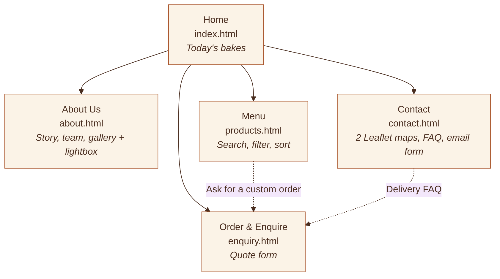
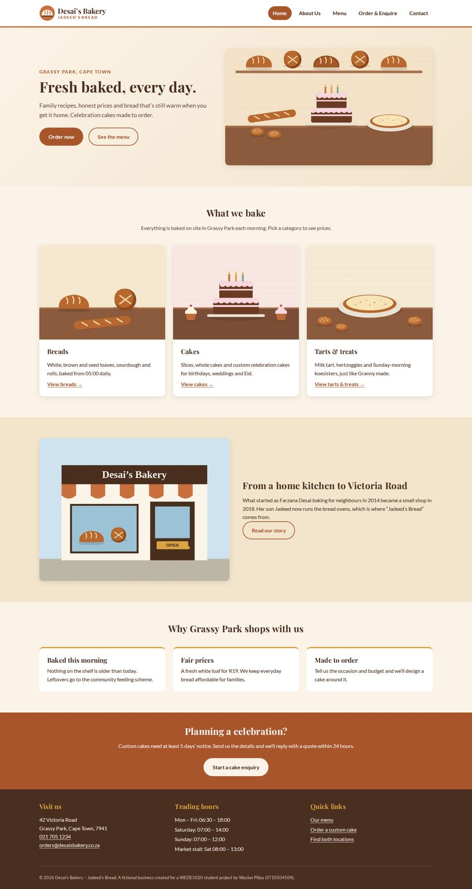
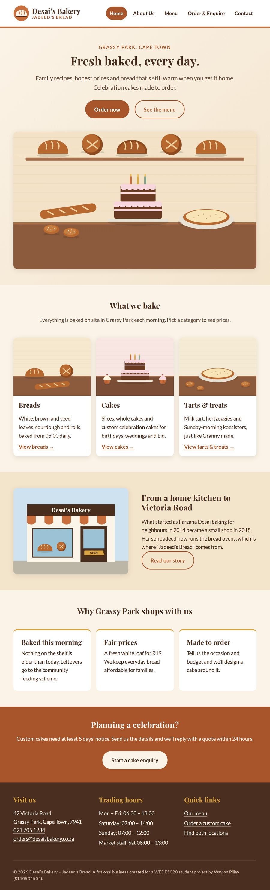
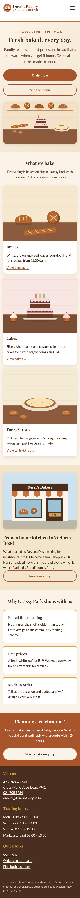
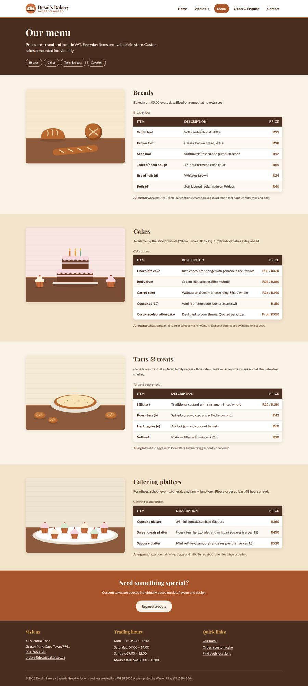
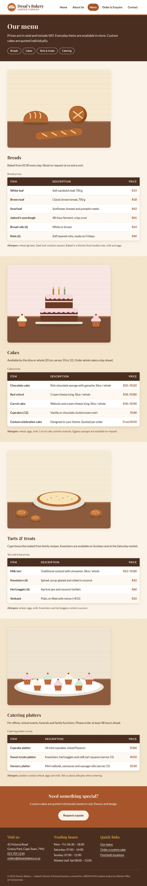
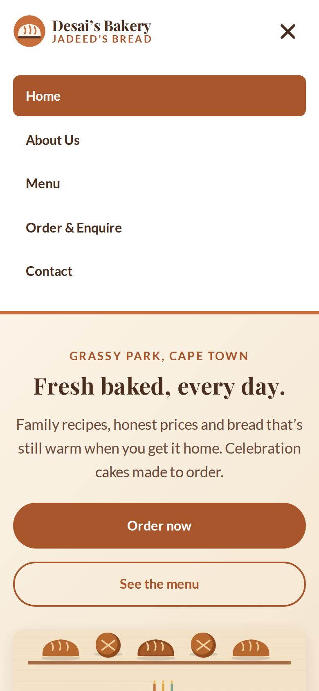

# Desai's Bakery – Jadeed's Bread

A five-page, responsive website for a fictional family bakery in Grassy Park, Cape Town. Built with HTML5 and CSS3 for the WEDE5020 Portfolio of Evidence (Parts 1 and 2).

---

## Student information

| | |
|---|---|
| **Name** | Waylon Pillay |
| **Student number** | ST10504504 |
| **Module** | WEDE5020 – Web Development (Introduction) |
| **Institution** | The IIE Rosebank College |
| **Submission** | Part 1 (HTML structure) and Part 2 (CSS styling and responsive design) – 25 September 2026 |

---

## Project overview

Desai's Bakery – Jadeed's Bread is a family bakery on Victoria Road, Grassy Park. It started in a home kitchen in 2014 and opened a shop in 2018. On Saturdays it also has a stall at the community market on Klip Road. Almost all orders currently come in by phone and word of mouth, and the bakery has no website.

This project gives the bakery its first website. Customers can:

- see the menu and prices without phoning
- find both locations on a map, with trading hours
- send a structured enquiry for custom cakes and catering

The business, people, addresses and phone numbers are **fictional**, but written to be realistic for a small bakery on the Cape Flats.

---

## Website goals and objectives

| Goal | KPI (measure of success) |
|---|---|
| Build an online presence beyond the immediate neighbourhood | Month-on-month growth in unique visitors for the first 6 months |
| Generate custom cake and catering leads | 15 to 20 enquiry form submissions per month by month 3 |
| Reduce repetitive phone calls | 25% fewer calls about hours, location or prices by month 6 |
| Work well on mobile | Lighthouse accessibility score of 90+ on mobile |
| Build trust | 5 written customer testimonials within 6 months |

---

## Key features and functionality

| Page | File | Key features |
|---|---|---|
| Home | `index.html` | Hero with tagline and calls to action, three category cards linking into the menu, story teaser, selling points, CTA banner |
| About Us | `about.html` | History, milestone timeline (ordered list), mission and vision, team cards, "Why choose us" |
| Menu | `products.html` | Four categories (breads, cakes, tarts & treats, catering) as HTML tables with prices, allergen notes, jump links |
| Order & Enquire | `enquiry.html` | Custom-order form with fieldsets, radio buttons, selects, date, number, file upload and textarea; HTML5 validation (`required`, `type`, `pattern`, `min`/`max`) |
| Contact | `contact.html` | **Two locations**, each with an embedded Google Map; contact details list; general contact form |

Features on every page:

- **Semantic HTML5 layout:** `header`, `nav`, `main`, `section`, `article`, `aside`, `footer` and `address`.
- **Navigation:** the same navigation on every page, with the current page highlighted (`aria-current="page"`).
- **Skip link:** a "Skip to main content" link for keyboard users.
- **Descriptive `alt` text** on every content image.
- **Code comments:** HTML comments explain every major section. `style.css` is split into 12 numbered, commented sections.

---

## Sitemap



Every page links to every other page through the header navigation, so any page is one click from any other.

---

## File and folder structure

```
WEDE5020-POE-ST10504504/
├── index.html            Home
├── about.html            About Us
├── products.html         Menu
├── enquiry.html          Order & Enquire (form)
├── contact.html          Contact (2 maps + form)
├── README.md
├── css/
│   └── style.css         The one external stylesheet, linked from all 5 pages
├── images/
│   ├── logo.svg
│   └── <name>-<width>.jpg / .webp   e.g. breads-480.jpg, breads-960.webp
├── fonts/                Self-hosted Playfair Display and Lato (.woff2)
├── docs/
│   └── sitemap.png
└── screenshots/          Desktop, tablet and mobile evidence
```

All file names are lowercase and use hyphens instead of spaces.

---

## Design (Part 2)

### Colour scheme

| Colour | Hex | Used for |
|---|---|---|
| Cream | `#FBF3E7` | Page background |
| Terracotta | `#C96F3E` | Decorative accents and borders |
| Dark terracotta | `#A9552B` | Buttons and links (darker so white text passes WCAG AA contrast) |
| Deep brown | `#4A2E20` | Body text, page banners, footer |
| Soft gold | `#D9A441` | Highlights and keyboard focus outlines |

All colours are stored once as CSS custom properties in `:root` and reused with `var()`.

### Typography

- **Headings:** Playfair Display, a warm serif with a hand-crafted feel.
- **Body:** Lato, a clean sans-serif that is easy to read in menus and forms.
- **Type scale in `rem`:** H1 2.75rem, H2 1.75rem, H3 1.25rem and body 1rem on desktop. The sizes get smaller at each breakpoint.
- **Self-hosted:** the fonts are stored in `/fonts` with `@font-face` and `font-display: swap`, so the site doesn't depend on an outside font service.

### CSS techniques used

- **CSS reset:** `box-sizing: border-box`, zero margins and responsive media defaults.
- **Layout:** CSS Grid for the page layouts (cards, split sections, footer, forms) and Flexbox for the header, buttons and radio groups.
- **Decoration:** `box-shadow`, `border-radius`, a gradient hero, zebra-striped tables and a timeline with `::before` dots.
- **Pseudo-classes:**
  - `:hover`, `:focus`, `:focus-visible` and `:active` on the navigation, buttons, cards, table rows and form fields
  - `:checked` for the mobile menu
  - `:nth-child` for table striping
  - `:user-invalid` for form errors
  - `::before` and `::after` for decorations

---

## Responsive design (Part 2)

The styles are written for desktop first. Three media queries then adjust the layout, typography, navigation and images:

| Breakpoint | Width | Main changes |
|---|---|---|
| Tablet | `max-width: 64em` (1024px) | Hero stacks into one column; menu images sit above the tables; forms go full width; heading sizes drop |
| Mobile | `max-width: 48em` (768px) | Hamburger menu (CSS-only, using the `:checked` checkbox technique); every grid becomes one column; menu table descriptions stack under the item name |
| Small mobile | `max-width: 30em` (480px) | Full-width tap-friendly buttons; smaller logo and H1; radio options stack |

- **Relative units:** `rem` and `em` are used for type and spacing, and `%` and `vw` for widths. The container is `width: 90%` with a `max-width` of 75rem.
- **Responsive images:** every image uses `<picture>` with a WebP `<source>` and a JPG fallback. Both use `srcset` (480w, 960w and 1600w for the hero) and `sizes`, so phones download the smaller files. `max-width: 100%` and `height: auto` stop images from overflowing.
- **Maps:** the map iframes keep a 4:3 shape at every width using `aspect-ratio`.

### Screenshot evidence

| Desktop (1440px) | Tablet (820px) | Mobile (390px) |
|---|---|---|
|  |  |  |
|  |  |  |

Mobile navigation (open):



Full-page screenshots of all five pages at all three sizes are in the [`screenshots/`](screenshots/) folder.

> Screenshots were taken with Chromium at the widths above. The embedded Google Maps need an internet connection, so they appear blank in offline screenshots.

---

## Testing

| Test | Result |
|---|---|
| W3C Nu HTML Checker (all 5 pages) | No errors or warnings |
| W3C CSS validation (`style.css`) | No errors |
| Internal links, anchors and image paths | All working (0 broken) |
| Browser | Chromium (the engine behind Chrome and Edge) |
| Screen widths | 1440, 1024, 820, 768, 390, 360 and 320px: no horizontal scrolling on any page |

---

## How to run

1. Clone the repository or download the ZIP.
2. Open `index.html` in any modern browser. No build step or server is needed.

---

## Timeline and milestones

| Week | Dates (2026) | Milestone |
|---|---|---|
| 1 | 17 – 21 Aug | Two proposals written and submitted |
| 2 | 24 – 28 Aug | Organisation approved; content research and sourcing |
| 3 | 31 Aug – 4 Sep | Sitemap, wireframes, folder structure, repository set up |
| 4 | 7 – 11 Sep | HTML for all five pages and navigation |
| 5 | 14 – 18 Sep | External stylesheet for desktop |
| 6 | 21 – 24 Sep | Responsive design, testing, screenshots, README |
| Due | 25 Sep | Parts 1 and 2 submitted |

---

## Changelog

### v2.0 – Part 2: CSS styling and responsive design (September 2026)

**Added**
- External stylesheet `css/style.css`, linked in the `<head>` of all five pages.
- CSS reset and base styles, including `box-sizing`, margins and responsive image defaults.
- Design tokens (custom properties) for the colour scheme, type scale, spacing, radius and shadow.
- Self-hosted Playfair Display and Lato fonts with `@font-face`.
- Desktop layouts with CSS Grid (hero, cards, split sections, menu blocks, forms, footer) and Flexbox (header, buttons, radio groups).
- Visual styles: shadows, rounded corners, gradient hero, zebra-striped menu tables and timeline dots.
- Pseudo-class states for navigation, buttons, cards, table rows and form fields: `:hover`, `:focus-visible`, `:active`, `:user-invalid` and `:nth-child`.
- Tablet (`64em`), mobile (`48em`) and small-mobile (`30em`) media queries, with changes to layout, typography, navigation and images.
- CSS-only hamburger navigation for mobile, using the `:checked` technique (MDN Web Docs, 2026a).
- Stacked table layout for the menu on mobile.
- Screenshot evidence at desktop, tablet and mobile sizes in `/screenshots`.

**Changed**
- Button and link colour darkened from `#C96F3E` to `#A9552B` so white text passes WCAG AA contrast. `#C96F3E` is kept for decorative accents.
- The skip link and hidden section headings are now visually hidden with CSS.

### v1.1 – Corrections to the Part 1 submission (September 2026)

These changes were made after reviewing the original Part 1 work against the brief and rubric.

- **Proposal: second proposal.** Added Proposal B (Vlei Paws Animal Rescue, an NPO), because the brief requires two proposals.
- **Proposal: formatting.** Fixed the heading styles. Body text had been formatted as headings, which broke the table of contents.
- **Proposal: timeline.** Replaced the placeholder week numbers with real dates leading up to 25 September 2026.
- **Proposal: budget.** Added development and maintenance labour, and sourced the domain and hosting costs.
- **Proposal: wireframes.** Redrew them for all five pages plus mobile. The logo and "Home" labels had overlapped in the originals.
- **Proposal: references.** Added access dates in IIE Harvard style, and cited every listed source in the text.
- **Location.** The bakery is now set in Grassy Park, Cape Town, with the main shop on Victoria Road and the market stall on Klip Road.
- **HTML rebuilt.** Rebuilt all five pages with full semantic HTML5 structure, comments, alt text and a working navigation menu.
- **Contact page.** Now has two embedded maps, one per location, as the brief requires.
- **Images.** Added original images at several sizes for responsive loading.

### v1.0 – Part 1: Initial submission (21 August 2026)

- Website Project Proposal submitted for Desai's Bakery – Jadeed's Bread.
- Initial five-page HTML structure planned: Home, About, Menu, Enquiry and Contact.

---

## References

Ashwin, S. 2026. *.co.za domain price increase 2026: what you need to know*. [Online]. Available at: https://hostafrica.co.za/blog/domains/co-za-domain-price-increase-2026/ [Accessed 23 September 2026].

Fontsource. 2026. *Lato and Playfair Display font packages (SIL Open Font License 1.1)*. [Online]. Available at: https://fontsource.org [Accessed 23 September 2026].

GitHub Docs. n.d. *About GitHub Pages*. [Online]. Available at: https://docs.github.com/en/pages [Accessed 23 September 2026].

Google. n.d. *Google Maps*. [Online]. Available at: https://maps.google.com [Accessed 23 September 2026].

Illidge, M. 2023. *How much it costs to host a basic website in South Africa*. MyBroadband. [Online]. Available at: https://mybroadband.co.za/news/cloud-hosting/513273-how-much-it-costs-to-host-a-basic-website-in-south-africa-2.html [Accessed 23 September 2026].

Luchavez, C. 2026. *50+ small business website statistics for 2026*. Network Solutions. [Online]. Available at: https://www.networksolutions.com/blog/small-business-website-statistics/ [Accessed 23 September 2026].

MDN Web Docs. 2026a. *:checked – CSS pseudo-class*. [Online]. Available at: https://developer.mozilla.org/en-US/docs/Web/CSS/:checked [Accessed 23 September 2026].

MDN Web Docs. 2026b. *Using media queries*. [Online]. Available at: https://developer.mozilla.org/en-US/docs/Web/CSS/Guides/Media_queries/Using [Accessed 23 September 2026].

MDN Web Docs. 2026c. *Using responsive images in HTML*. [Online]. Available at: https://developer.mozilla.org/en-US/docs/Web/HTML/Guides/Responsive_images [Accessed 23 September 2026].

Nielsen, J. 1994. *10 usability heuristics for user interface design*. Nielsen Norman Group. [Online]. Available at: https://www.nngroup.com/articles/ten-usability-heuristics/ [Accessed 23 September 2026].

Qrolic. 2025. *How to design a website for a local bakery: best practices*. [Online]. Available at: https://qrolic.com/blog/create-bakery-website-that-gets-customers/ [Accessed 23 September 2026].

SoloHourly. 2026. *Freelance web developer rates in South Africa (2026)*. [Online]. Available at: https://solohourly.com/rates/web-developer-rates-in-south-africa [Accessed 23 September 2026].

W3C. 2023. *Web Content Accessibility Guidelines (WCAG) 2.2*. [Online]. Available at: https://www.w3.org/TR/WCAG22/ [Accessed 23 September 2026].

**Images:** all images in `/images` (bakery illustrations and logo) are original work created for this project. No third-party photographs are used.
